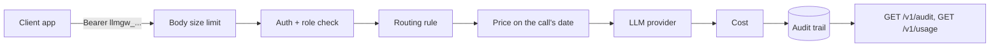

# LLM Gateway

[](https://github.com/NicoleAlice/LLM-Gateway/actions/workflows/ci.yml)

A multi-tenant gateway that sits between applications and LLM providers and controls **who can call which model, what each call costs, and what happened on every call**.

> **Status:** Phase 1 (in-memory) is complete: keys, roles, routing, date-effective billing, `/v1/chat` and an audit row for every chat attempt, behind 247 tests, plus keyset pagination for the audit trail. Storage is in memory and the only provider is a built-in fake; PostgreSQL and a real Anthropic provider are next. See the [roadmap](#roadmap).

## Features

| | Status |
|---|---|
| **Tenants and API keys**: hashed keys, roles (`admin`, `developer`, `viewer`), instant revocation | ✅ |
| **Model routing**: per-tenant `preferred` / `mandatory` model rules | ✅ |
| **`POST /v1/chat`**: routed, priced and audited; fake provider for local use | ✅ |
| **Audit trail**: one row per attempt, failures included (model, provider, tokens, cost, latency) | ✅ |
| **Usage-based billing**: date-effective prices; only answered calls are billed | ✅ |
| **One error contract** for every response, including 404, 413, 422 and 500 | ✅ |
| PostgreSQL storage, Anthropic provider | planned (next) |
| **Keyset pagination** for `/v1/audit` (`limit`, opaque `cursor`) | ✅ |
| Quotas and budgets, SSE streaming, OpenTelemetry, Prometheus | planned (Phase 2) |
| Docker Compose, Helm chart | planned (Phase 3) |

## Architecture



The model and its price are resolved **before** the provider is called, so a call the gateway couldn't bill is never made. Domain logic lives in small pure modules (`auth/keys.py`, `routing/rules.py`, `billing/pricing.py`); the routes in `api/` only translate between HTTP and those modules. Storage (tenants, keys, routing rules, audit) sits behind async `Protocol`s with in-memory implementations, so PostgreSQL can replace them with almost no route changes; the one exception is the last-admin check on key revocation, which needs an atomic repository method first.

## Quickstart

Needs [uv](https://docs.astral.sh/uv/). Start the server in one terminal:

```bash
uv sync
export LLMGW_ADMIN_TOKEN="dev-admin-token-123"   # at least 16 characters
uv run uvicorn --factory llm_gateway.main:create_app
```

Then, in another terminal (same `LLMGW_ADMIN_TOKEN`):

```bash
BASE=http://127.0.0.1:8000

# 1. Create a tenant with the deployment's admin token; you get its first admin key
ADMIN_KEY=$(curl -s -X POST "$BASE/v1/admin/tenants" \
  -H "X-Admin-Token: $LLMGW_ADMIN_TOKEN" -H "Content-Type: application/json" \
  -d '{"name": "acme"}' | sed -E 's/.*"admin_key":"([^"]+)".*/\1/')

# 2. A developer key (calls models) and a viewer key (reads usage)
DEV_KEY=$(curl -s -X POST "$BASE/v1/admin/keys" -H "Authorization: Bearer $ADMIN_KEY" \
  -H "Content-Type: application/json" -d '{"role": "developer"}' \
  | sed -E 's/.*"key":"([^"]+)".*/\1/')
VIEWER=$(curl -s -X POST "$BASE/v1/admin/keys" -H "Authorization: Bearer $ADMIN_KEY" \
  -H "Content-Type: application/json" -d '{"role": "viewer"}')
VIEWER_KEY=$(echo "$VIEWER" | sed -E 's/.*"key":"([^"]+)".*/\1/')
VIEWER_ID=$(echo "$VIEWER" | sed -E 's/.*"key_id":"([^"]+)".*/\1/')

# 3. Chat: answered by the built-in fake provider (no LLM account needed)
curl -s -X POST "$BASE/v1/chat" -H "Authorization: Bearer $DEV_KEY" \
  -H "Content-Type: application/json" \
  -d '{"messages": [{"role": "user", "content": "hello gateway"}]}'; echo

# 4. What it cost, read from the audit trail (write offsets as Z, or + as %2B)
TODAY=$(date -u +%Y-%m-%d)
USAGE="$BASE/v1/usage?start=${TODAY}T00:00:00Z&end=${TODAY}T23:59:59Z"
curl -s "$USAGE" -H "Authorization: Bearer $VIEWER_KEY"; echo

# 5. Revocation is instant: the next request with that key is rejected
curl -s -o /dev/null -X DELETE "$BASE/v1/admin/keys/$VIEWER_ID" -H "Authorization: Bearer $ADMIN_KEY"
curl -s "$USAGE" -H "Authorization: Bearer $VIEWER_KEY"; echo
```

Output (from a real run):

```text
{"provider":"fake","model":"fake-echo","content":"echo: hello gateway","usage":{"input_tokens":2,"output_tokens":3},"cost_usd":"0.000008"}
{"total_cost_usd":"0.000008","by_model":[{"model":"fake-echo","calls":1,"input_tokens":2,"output_tokens":3,"cost_usd":"0.000008"}]}
{"error":{"code":"invalid_api_key","message":"invalid or missing API key"}}
```

The fake provider counts words as tokens and is priced at $1 / $2 per million input / output tokens: 2 × $1 + 3 × $2 = $8 per million, so `0.000008`.

<details>
<summary>PowerShell version</summary>

```powershell
# Server: $env:LLMGW_ADMIN_TOKEN = "dev-admin-token-123"; uv run uvicorn --factory llm_gateway.main:create_app
$Base = "http://127.0.0.1:8000"
$tenant = Invoke-RestMethod -Method Post "$Base/v1/admin/tenants" `
  -Headers @{ "X-Admin-Token" = $env:LLMGW_ADMIN_TOKEN } -ContentType "application/json" -Body '{"name": "acme"}'
$admin = @{ Authorization = "Bearer $($tenant.admin_key)" }
$devKey = (Invoke-RestMethod -Method Post "$Base/v1/admin/keys" -Headers $admin `
  -ContentType "application/json" -Body '{"role": "developer"}').key
$viewer = Invoke-RestMethod -Method Post "$Base/v1/admin/keys" -Headers $admin `
  -ContentType "application/json" -Body '{"role": "viewer"}'

Invoke-RestMethod -Method Post "$Base/v1/chat" -Headers @{ Authorization = "Bearer $devKey" } `
  -ContentType "application/json" -Body '{"messages": [{"role": "user", "content": "hello gateway"}]}'

$today = (Get-Date).ToUniversalTime().ToString("yyyy-MM-dd")
Invoke-RestMethod "$Base/v1/usage?start=${today}T00:00:00Z&end=${today}T23:59:59Z" `
  -Headers @{ Authorization = "Bearer $($viewer.key)" } | ConvertTo-Json -Depth 5

Invoke-RestMethod -Method Delete "$Base/v1/admin/keys/$($viewer.key_id)" -Headers $admin
# The revoked viewer key now gets 401 invalid_api_key.
```

</details>

Interactive API docs are at `http://127.0.0.1:8000/docs`.

## API

| Endpoint | Who | What |
|---|---|---|
| `POST /v1/admin/tenants` | deployment admin token (`X-Admin-Token`) | Create a tenant and its first admin key |
| `POST /v1/admin/keys` · `GET` · `DELETE /v1/admin/keys/{id}` | tenant `admin` | Create, list (never shows secrets) and revoke keys |
| `GET` · `PUT` · `DELETE /v1/admin/routing` | tenant `admin` | The tenant's routing rule |
| `POST /v1/chat` | `developer` | Routed, priced, audited chat completion |
| `GET /v1/audit?start=&end=&limit=&cursor=` | `viewer`, `admin` | Every attempt in a `[start, end)` window (max 366 days), oldest first, as `{"items": [...], "next_cursor": ...}`; `limit` 1-1000 (default 100). Rows in the same instant come back in an arbitrary but stable order. Pages never repeat a row, but a row is timestamped when its call starts and stored when it ends, so a walk can miss a slow call that finished after it passed that timestamp: for a complete export, use a window that ended longer ago than your slowest call plus 5 s (there is no provider timeout yet) |
| `GET /v1/usage?start=&end=` | `viewer`, `admin` | Billed calls grouped by model, with totals |

Every error has the same shape: `{"error": {"code": "...", "message": "..."}}`.

## Design decisions

**Only answered calls are billed.** A call's audit row starts as a failure and becomes billable only as the very last step, after the provider answered and the response was built. A failure anywhere before that (unknown model, missing price, provider error, a crash while building the response) is recorded with cost 0. An early version marked the call billable before building the response; a review reproduced a request that returned 500 but was billed in full, and that ordering is now pinned by a test.

**One audit row per chat attempt, and the audit never under-reports a bill.** Every `/v1/chat` request that passes authentication and validation writes one row, in `finally`, inside an `anyio` scope shielded from cancellation and bounded by a timeout, so a request cancelled mid-call (for example during shutdown) still leaves its row, and a hung store can't hold shutdown forever. A test cancels the route mid-call (hanging provider, a store that really awaits) and checks that the row is kept and the cancellation re-raised. Writing the row never masks the original error. If a row can't be written, it is logged with a reconciliation line (tokens and cost, no prompt), and an *answered* call **fails closed** (500 `audit_unavailable`, answer not returned). The only unaudited path is a clock that itself fails. Storage is still in memory, so rows don't survive a restart until Phase 1b.

**Prices are resolved by the call's date.** Each model has a history of prices with an `effective_from` date; a call is billed at the price in force on its own (UTC) date, so a price change mid-month bills each call correctly. One clock reading per request sets both the price date and the audit timestamp. Money is `Decimal` end to end, never `float`, rounded to a micro-dollar with `ROUND_HALF_UP`. A model with no price today is refused (503) **before** the provider is called.

**API keys: SHA-256, bound to a public prefix.** A key looks like `llmgw_<12-hex prefix>_<43-char secret>`. The prefix is public (it shows in lists and the audit trail); only `sha256("<prefix>:<secret>")` is stored, compared in constant time. SHA-256 rather than bcrypt because the secret is 256 random bits, not a human password, so a slow hash adds cost on every request and no security. Binding the prefix into the hash stops a stolen hash being moved to another key's row. The whole key is validated by a strict pattern before anything is hashed, so malformed input never reaches the crypto.

**Revocation is instant.** Keys are looked up on every request; there is no cache, so a revoked key fails on its very next request. A request already in flight when the key is revoked still completes. A key cache would need either a short TTL or a revocation broadcast. A tenant's last active admin key can't be revoked, so a tenant can't lock itself out.

**Fail closed on configuration problems, and say whose fault it is.** An unknown model is a 400 `unknown_model`. A routing rule that points at a model no longer in the catalog is a 400 `routing_rule_invalid`, so the developer knows the tenant's configuration is broken, not their request, and the audit row records the model the rule chose. A mandatory rule is never silently bypassed.

**Nothing secret leaves in an error.** Every API-key failure returns the same 401 (`invalid_api_key`), whatever went wrong. Validation errors (422) list field paths only. Pydantic's own error details include the raw input, which could be a prompt or a key, so they are never serialized. Provider failures are logged by exception type only, because upstream messages can echo the prompt.

**Bodies are size-limited before authentication.** FastAPI decodes a JSON body before it runs auth dependencies, so without a limit an anonymous caller could make the server buffer any amount. A pure-ASGI middleware refuses bodies over 1 MiB (413), by `Content-Length` without reading them, or by counting bytes as they stream.

## How it was built and tested

- **Test-first, task by task**, from a written plan ([docs/superpowers/plans/](docs/superpowers/plans/2026-11-17-phase-1-core.md)).
- **Mutation testing** on every task: the code is deliberately broken in 253 specific ways (accept revoked keys, bill failed calls, skip the secret check, drop the cancellation shield, repeat a row across pages…) to prove the tests catch each one. On the current code 252 are caught; the remaining one is a documented equivalent mutant (a default value no code path can observe). The scripts and results are in [docs/mutation/](docs/mutation/README.md).
- **An independent adversarial review** of every security-relevant change, then a fix and a test for each finding.
- **CI** on every push to `main` and every pull request: `ruff check`, `ruff format --check`, `mypy` (strict) and `pytest` with coverage.

```bash
uv run pytest              # 247 tests
uv run mypy                # strict
uv run ruff check . && uv run ruff format --check .
```

## Roadmap

- [x] **Phase 1a: core, in memory**: tenants, API keys, RBAC, revocation, routing rules, `/v1/chat`, audit, date-effective billing, fake provider
- [ ] **Phase 1b: persistence and a real provider**: ~~keyset pagination for `/v1/audit`~~ and ~~usage aggregated by the repository~~ (done), an atomic last-admin check, Anthropic provider, PostgreSQL + Alembic
- [ ] **Phase 2: FinOps and operations**: quotas and budgets, SSE streaming, OpenTelemetry traces, Prometheus metrics, rate limiting
- [ ] **Phase 3: deployment**: Dockerfile, Docker Compose, Helm chart tested on `kind`

## Tech stack

Python 3.12 · FastAPI · Pydantic v2 · anyio · pytest · uv · ruff · mypy (strict) · GitHub Actions. SQLAlchemy, Alembic and PostgreSQL arrive in Phase 1b.
